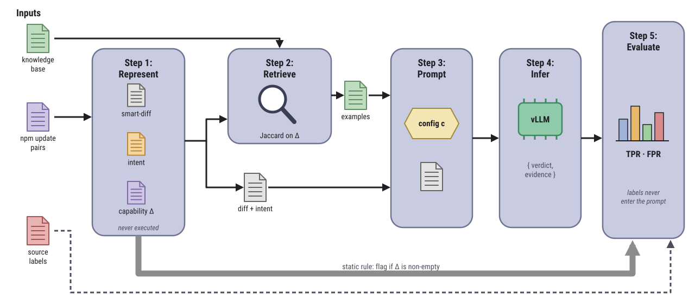

# Architecture

The three components, how they share `data/`, and the operational traps.
The research design is in the other `.agent/` files; this one covers how the code runs.

## Pipeline



| Step | Module | Notes |
|---|---|---|
| 1 Represent | `smartdiff.py`, `intent.py`, `capability.py` | static only; intent from the predecessor version |
| 2 Retrieve | `runner.py` (`retrieve`) | Jaccard on Δ; drops the pair's own name, campaign and dependencies |
| 3 Prompt | `prompts.py`, `configs.py` | configuration `c` decides intent and M / MM / MB examples |
| 4 Infer | `runner.py`, `output_schema.py` | vLLM with a JSON Schema; invalid output is kept, judged in analysis |
| 5 Evaluate | `analysis.py`, `paper_results.py` | TPR, FPR, paired tests; `paper_results.py` also scores the static rule (flag if Δ ≠ ∅) |

Source labels and campaign clusters reach step 5 only, never the prompt.

## Components

**`pipeline/`**: experiment runner and data preparation, Python. A batch, not a
service: read pairs, run each configuration against vLLM's OpenAI-compatible
endpoint (D46), append one line per run. Configuration ids name their factors
(`DIFF`, `DIFF+I`, `DIFF+I+M`, `DIFF+I+MM`, `DIFF+I+MB`, `DIFF+MB`, D62) and live
in one table in `pipeline/configs.py`; the superseded `E0`–`E4` ids are rejected.

```
uv run pipeline/runner.py --model Qwen/Qwen3-4B-Instruct-2507   # --base-url defaults to :8101
uv run pipeline/runner.py --selfcheck
```

- **Resumable**: runs already in `results.jsonl` are skipped, so the batch can
  stop at any time.
- **Sequential on purpose**: RQ4 reports median and p95 latency, which are wrong
  if requests overlap on the server.
- **GPU memory is not measured by the runner.** Never report an nvidia-smi peak:
  vLLM pre-allocates per `--gpu-memory-utilization`. methodology §9.3
  (D41) defines what to report.

**`backend/`**: API for the audit UI, Rust + axum. A library crate served by
`main.rs`; one directory per feature under `src/modules/` (`pairs`, `audit`),
each with `routes.rs`, `handlers.rs`, `dto.rs`, `repository.rs`; shared helpers
in `src/shared/`; router-level tests in `backend/tests/`.

```
cd backend && cargo run -- --data-dir ../data --port 8100
```

| Route | Purpose |
|---|---|
| `GET /api/pairs` | pairs plus the file they came from |
| `GET /api/results?pair_id=` | runs of one pair |
| `GET /api/decisions?annotator=` | the caller's own decisions |
| `PUT /api/decisions?id=&annotator=` | merge a patch into one decision |
| `GET /api/annotators` | counts per annotator, never labels |
| `GET /health` | liveness |

**`frontend/`**: research tooling, label audit (M1–2) and error analysis
(M7–8). Vite + React + TypeScript + Tailwind. Proxies `/api` to port 8100, so
the backend must be up first.

## Data

The backend serves files, not a database: the runner and the backend read and
write the same `data/` directory. Input datasets are never modified.

- The backend reads `data/pairs.jsonl`, falling back to `data/pairs.sample.jsonl`
  (and `results.jsonl` to `results.sample.jsonl`). Label review uses the
  separate `data/review/` directory: `make backend DATA=data/review`.
- **Double annotation (§8)**: each annotator writes
  `data/audit_decisions.<annotator>.json`. `GET /api/annotators` reports counts
  only, so labelling stays independent.
- Decision writes hold a mutex and land through an atomic rename: two nearby
  clicks cannot overwrite each other, and a crash mid-write cannot truncate the file.

## Ports and the GPU host

| Port | Owner |
|---|---|
| 5174 | frontend (Vite, or nginx in Docker) |
| 8100 | backend |
| 8101 | vLLM |
| 8000 and several others | production services on the GPU host; do not use |

- Run `docker ps` before changing ports in `.env`. In Docker the backend is
  published on loopback and reached through nginx.
- vLLM runs from the official image (pinned by digest). Default model is
  `Qwen2.5-Coder-3B`; Qwen3-4B does not fit in 12 GiB (D44).
- vLLM pre-allocates VRAM as a fraction of the **total** card, so
  `VLLM_GPU_UTIL` must be sized against what is actually free, or it starves the
  production service sharing the card. Steps: `deployments/README.md`.
