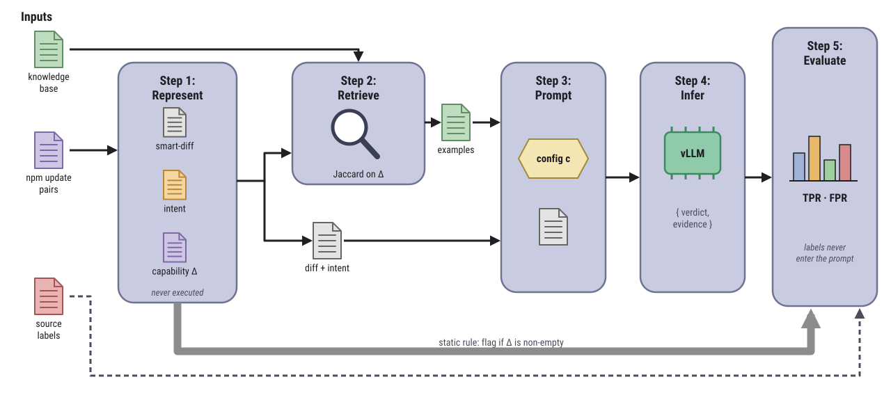

# Contributing to IntentDiff-RAG

Follow these steps and note these guidelines to begin contributing:

1. Set up the local development environment (see [Toolchain](#toolchain)).
2. Bug fixes are always welcome. Start with the open issues labelled `bug` in the
   repository's **Issues** tab.
3. A good way to start is an issue labelled `good first issue`. If something is
   unclear, ask on the issue.

Everyone taking part follows the [Code of Conduct](CODE_OF_CONDUCT.md).

---

# How IntentDiff-RAG is organised

IntentDiff-RAG is a research experiment, not a production scanner. It measures
how a package's stated purpose and in-context reference examples change what
small, locally run language models flag as a malicious npm update.

## Pipeline

<p align="center">
  
</p>

[`.agent/architecture.md`](.agent/architecture.md) maps each step to its module.

## Repository structure

```text
intendiff_rag/
├── pipeline/       experiment runner and data preparation (Python, uv)
├── backend/        audit UI API (Rust, axum)
├── frontend/       audit UI (React, TypeScript, Vite)
├── tests/          pipeline unit tests
├── data/           pair manifests, knowledge base, frozen evaluation releases
├── deployments/    Docker images and the GPU host guide
├── scripts/        batch scripts for the evaluation runs
├── .agent/         design summary, conventions, architecture and status
├── .githooks/      commit-msg, pre-commit and pre-push checks
└── Makefile        task targets
```

The manuscript, the full design documents (`docs/`) and the decision log live on
the `latex` branch.

## Research rules

These hold for every change, because they decide whether a result can be trusted:

- **Malicious samples are analysed statically only.** Never install or execute
  them, never run their lifecycle scripts, never call an endpoint found inside one.
  Sample archives never enter git.
- **The design is frozen.** A change to a prompt, configuration, capability list
  or decision rule needs an entry in `docs/decisions.md` on the `latex` branch,
  and every configuration is re-run. Never tune against test-set results.
- **Report numbers as they come out.** A configuration losing to the baseline is
  a result, not a bug.
- **Frozen releases stay frozen.** Directories under `data/evaluation/` keep a
  pinned copy of the code they ran in `code/`. Fix the live module in
  `pipeline/`, never the copy. [`.agent/status.md`](.agent/status.md) lists them.

---

# How to contribute

## Fork the repository

Click **Fork** on the repository's main page, choose your account as the owner
and click **Create fork**. Then clone your fork:

```sh
git clone git@github.com:<your-account>/intendiff_rag.git
cd intendiff_rag
make hooks
```

`make hooks` enables the commit hooks (see [Commit messages](#commit-messages)).

## Creating an issue

- Open the **Issues** tab and click **New issue**.
- Give it a clear title. In the description, say what you expected, what
  happened, and how to reproduce it: the command, the commit, and the relevant
  log or result lines.
- Preview it, then click **Submit new issue**.
- To work on it, comment on the issue and wait for a maintainer to assign it.

Report security problems privately instead; see [SECURITY.md](SECURITY.md).

## Working on an issue

Create one branch per issue. Several issues on one branch make the review harder.

```sh
git switch -c fix/short-description
```

## Toolchain

| Work on | Needs |
|---|---|
| pipeline and its tests | Python 3.12+, [uv](https://astral.sh/uv) |
| backend | Rust (stable) |
| frontend | Node 22+, pnpm (version pinned in `frontend/package.json`) |
| running the UI without the toolchain | Docker with Compose |
| running a model | an NVIDIA GPU, vLLM (`docker compose --profile model up -d`) |

To run the audit UI without installing anything else:

```sh
docker compose up -d --build   # http://localhost:5174
```

## Using the Makefile

Run these from the repository root:

| Target | What it does |
|---|---|
| `make` | list the targets |
| `make venv` | create `.venv` from `uv.lock` |
| `make install` | install the frontend dependencies |
| `make hooks` | enable the hooks in `.githooks/` |
| `make backend` | run the API on :8100 |
| `make ui` | run the UI on :5174 (start the backend first) |
| `make test` | run every suite |
| `make test-backend`, `test-frontend`, `test-pipeline` | one suite; CI runs these |

## Using uv

The pipeline uses [uv](https://astral.sh/uv). Add a dependency with an exact
version and commit `pyproject.toml` and `uv.lock` together:

```sh
make venv
uv run pipeline/runner.py --selfcheck
uv add <package>==<version>
```

## Testing changes

Add a check with every non-trivial change: a Rust test, a Vitest file, a
`--selfcheck` flag on a pipeline module, or a `tests/test_*.py` file. Wire it
into the matching `make test-*` target so CI runs it.

```sh
make test
```

`make test` needs no GPU, no network and no samples. A change to how the runner
talks to vLLM also needs a short run against a real server.

## Code style

- The smallest code that solves the problem; delete before adding; clear names
  over comments.
- One reason to change per file. A new configuration is a new row in
  `pipeline/configs.py`, not a new branch in several files.
- Comments are rare and short, and explain why, never what.
- Rust is formatted with `cargo fmt`; clippy runs with warnings as errors.

[`.agent/conventions.md`](.agent/conventions.md) has the full rules.

## Commit messages

The `commit-msg` hook checks the first line against
[Conventional Commits](https://www.conventionalcommits.org):

```text
type(scope): description
```

- Types: `feat`, `fix`, `refactor`, `test`, `docs`, `build`, `chore`.
- Scopes: `pipeline`, `backend`, `frontend`, `data`, `docs`, `compose`,
  `deploy`; omit for repository-wide changes.
- Lowercase, imperative, at most 72 characters, no trailing period.

```text
fix(pipeline): retry connection resets, which bypassed the backoff
feat(frontend): filter pairs by subset
docs: describe the audit ui setup
```

The `pre-commit` hook rejects sample archives, secrets, PDFs, IP addresses and
home-directory paths, and checks `cargo fmt` when `backend/` changes. The
`pre-push` hook runs `make test`.

## AI-assisted contributions

AI tools are welcome. The person who opens the pull request answers for all of it:

- Read and understand every change, and test it. It gets the same review as any other code.
- Check that the tool's terms allow contributing its output under this project's license.
- When the output holds third-party code, confirm the license allows it, and give its notice and attribution.
- Never let a tool run sample code or install a sample package.

Say in the pull request when an AI tool wrote a substantial part of the change.

## Pushing changes

```sh
git commit -m "fix(pipeline): <what changed>"
git push origin fix/short-description
```

Then open your fork on GitHub, select the branch and click **Compare & pull
request**. Check that the base is `main`, describe what changed and how you
tested it, and link the issue (`Closes #12`). Further pushes to the same branch
update the pull request.

A pull request merges once a maintainer approves it and the `backend`,
`frontend`, `pipeline`, `docker` and `codeql` checks pass.

---

# Adding to the experiments

## A configuration

Configurations live in one table, `pipeline/configs.py`. An id spells out its
factors: `DIFF` smart-diff, `I` intent block, `M` malicious example, `B` benign
example.

```python
CONFIGS = {
    "DIFF": Config(intent=False, cards=()),
    "DIFF+I+MB": Config(intent=True, cards=("malicious", "benign")),
    # ...
}
```

A new configuration is a new row there. It changes the design, so it needs a
decision entry first (see [Research rules](#research-rules)).

## A model

Any model vLLM serves can be run:

```sh
uv run pipeline/runner.py --model <hf-model-id>   # vLLM on :8101
```

A model enters the evaluation only after it passes the dev gate: at least 90 %
valid JSON on the dev set. Do not lower the threshold for a model that misses it.
