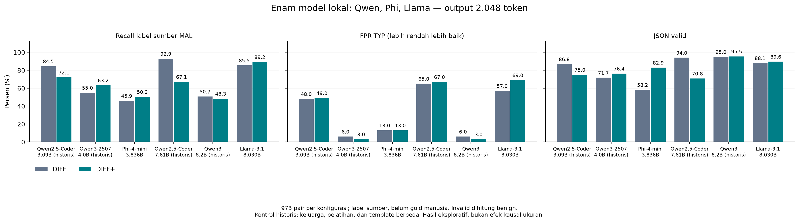

# Eksplorasi lintas keluarga model — 1 Oktober 2026 (D84)

**Selesai 1 Oktober 2026, 09:24 WIB: 3.892 respons baru unik terverifikasi,
tanpa error transport atau pengulangan request evaluasi.** Pembanding kini
enam model, dua konfigurasi masing-masing, total 11.676 respons pada output
2.048 token. Llama memberi recall tinggi dengan FPR tinggi; Phi belum
mengungguli Qwen3-4B pada kedua metrik tersebut.

Pengguna meminta
eksplorasi model lain setelah D83 selesai. Dua model dipilih berdasarkan
akses, dukungan runtime, konteks, dan memori sebelum melihat prediksi.

## Model terpilih

| Model | Parameter aktual dari metadata snapshot | Kelompok | Pembanding historis |
|---|---:|---|---|
| [Microsoft Phi-4-mini-instruct](https://huggingface.co/microsoft/Phi-4-mini-instruct) | 3,836B (nominal 3,8B) | A: 1 ≤ P < 5B | Qwen2.5-Coder-3B dan Qwen3-4B-Instruct-2507 |
| [Meta Llama-3.1-8B-Instruct](https://huggingface.co/meta-llama/Llama-3.1-8B-Instruct) | 8,030B (nominal 8B) | B: 5 ≤ P < 10B | Qwen2.5-Coder-7B dan Qwen3-8B |

Phi menambah keluarga model kecil, Llama menambah keluarga sekitar 8B.
Keduanya adalah pembanding instruction-tuned umum; tidak diklaim sebagai
detektor npm yang dilatih khusus. Ini bukan replikasi skor paper pada
dataset atau metode lain, dan tidak mengisolasi efek jumlah parameter.
Greedy digunakan sebagai kontrol bersama, bukan klaim setting optimal
masing-masing pengembang.

## Hasil baru dan perbandingan

| Model baru | Konfigurasi | Recall MAL sumber | FPR TYP | JSON valid | Macro recall kampanye |
|---|---|---:|---:|---:|---:|
| Phi-4-mini-instruct | DIFF | 45,93% (401/873) | 13% | 58,17% (566/973) | 35,87% |
| Phi-4-mini-instruct | DIFF+I | 50,29% (439/873) | 13% | 82,94% (807/973) | 38,12% |
| Llama-3.1-8B-Instruct | DIFF | 85,45% (746/873) | 57% | 88,08% (857/973) | 76,44% |
| Llama-3.1-8B-Instruct | DIFF+I | 89,23% (779/873) | 69% | 89,62% (872/973) | 86,67% |

FPR memakai 100 TYP yang diasumsikan benign. Invalid dihitung benign pada
metrik primer. Hasil lengkap dua belas baris tersedia pada
[tabel enam model](../data/evaluation/model-families-20261001/comparison.md),
[CSV](../data/evaluation/model-families-20261001/comparison.csv), dan
[JSON termasuk sensitivitas/biaya](../data/evaluation/model-families-20261001/comparison.json).

**Phi belum memperbaiki trade-off terhadap Qwen3-4B.** Pada DIFF, recall
turun 9,05 poin dan FPR naik 7 poin; pada DIFF+I, recall turun 12,94 poin
dan FPR naik 10 poin. Phi DIFF memiliki 407 invalid (281 sintaks, 124
terpotong, 2 skema), sedangkan DIFF+I 166 invalid (95 sintaks, 71 terpotong).

Kenaikan Phi DIFF → DIFF+I sebesar 38 deteksi MAL terdiri dari +139 melalui
transisi yang melibatkan invalid dan −101 pada pasangan yang kedua
responsnya valid. Jadi kenaikan recall primer 4,35 poin tidak dapat langsung
diartikan sebagai peningkatan penalaran akibat intent. Ini dekomposisi
deskriptif, bukan estimasi kausal.

**Llama memberi alternatif, tetapi belum menjadi pemenang menyeluruh.**
Terhadap Qwen2.5-7B pada DIFF, recall Llama lebih rendah 7,45 poin dan FPR
lebih rendah 8 poin. Pada DIFF+I, recall Llama lebih tinggi 22,11 poin,
tetapi FPR lebih tinggi 2 poin. Tambahan 193 deteksi MAL pada perbandingan
DIFF+I tersebut terdiri dari +192 melalui transisi valid/invalid dan
hanya +1 pada pasangan yang keduanya valid. Keunggulan angka ini banyak
terkait konsistensi format terhadap Qwen2.5-7B DIFF+I.

Di dalam Llama sendiri, DIFF → DIFF+I menambah 33 deteksi MAL: +20 pada
pasangan sama-sama valid dan +13 melalui transisi valid/invalid, disertai
12 tambahan false positive TYP. Dibanding Qwen3-8B, Llama jauh lebih tinggi
recall-nya, tetapi juga lebih tinggi FPR-nya. Bahkan Qwen2.5-7B DIFF masih
memiliki recall lebih tinggi dan FPR lebih rendah daripada Llama DIFF+I
(92,90%/65% versus 89,23%/69%). Jangan memilih model hanya dari recall.

Pada kelompok kecil, Qwen3-4B DIFF+I tetap memiliki recall lebih tinggi dan
FPR lebih rendah daripada kedua konfigurasi Phi dalam data ini. Semua
perbandingan bersifat eksploratif; belum ada klaim signifikansi statistik
atau generalisasi ke populasi paket npm.

[Diagnosis berpasangan](../data/evaluation/model-families-20261001/diagnostics.json)
menyimpan seluruh delapan perbandingan terhadap kontrol ukuran sebanding
dan dua perbandingan DIFF → DIFF+I. Hasil akhir terverifikasi melalui
[audit independen](../data/evaluation/model-families-20261001/verification.json).

## Sensitivitas dan biaya

Jika invalid dihitung malicious, recall/FPR Phi DIFF menjadi 90,38%/32%,
Phi DIFF+I 67,93%/25%, Llama DIFF 97,02%/72%, dan Llama DIFF+I 99,31%/82%.
Besarnya perubahan memperlihatkan pengaruh kebijakan invalid, terutama
pada Phi DIFF. Nilai sensitivitas ini tidak menggantikan metrik primer.

Total keluaran baru: 790 invalid dari 3.892 respons, termasuk 219 terpotong
(195 Phi, 24 Llama), 568 kesalahan sintaks, dan 3 ketidaksesuaian skema.
Total token: 16.044.387 prompt dan 1.024.496 completion. Median/p95 latency
dalam ms: Phi DIFF 1.058,7/20.167,7; Phi DIFF+I 945,6/21.062,9;
Llama DIFF 1.342,4/12.024,7; Llama DIFF+I 1.381,9/13.325,0.
Perbedaan cache dan sesi menghalangi klaim kausal kecepatan antar model.

Setiap model menyelesaikan 1.946 request generasi HTTP 200 dan dua request
tokenisasi HTTP 200. Seluruh token prompt aktual cocok dengan audit, tanpa
pemotongan tambahan. 30 checksum sumber aktif, 13 checksum kontrol, dan 27
sumber pada arsip protokol awal cocok. Tidak ada perubahan protokol setelah
prediksi pertama. Kedua server berhenti normal. Kegagalan startup sebelum
prediksi dan amendemen cache tetap dicatat di bawah; tidak disembunyikan
sebagai run yang dibuang.

## Audit kandidat tanpa inferensi

Lima model ditokenisasi pada seluruh 973 pair × dua konfigurasi. Seluruh
pesan dibuat dari snapshot prompt/input D83 yang tidak diubah. Kolom
"melampaui" mencakup cadangan output 2.048 token; hitungan adalah prompt,
bukan jumlah pair unik. Tidak ada prediksi LLM pada tahap pemilihan ini.

| Kandidat | Konteks native | Prompt maksimum | Prompt melampaui native | Keputusan |
|---|---:|---:|---:|---|
| Phi-4-mini-instruct | 131.072 | 29.919 | 0 | Dipilih; server 32.768 |
| Llama-3.1-8B-Instruct | 131.072 | 29.186 | 0 | Dipilih; akses yang tersedia berhasil, server 32.768 |
| Mistral-7B-Instruct-v0.3 | 32.768 | 39.236 | 109 | Tidak muat untuk seluruh input; perlu jalur dengan input disamakan |
| Granite-3.3-8B-Instruct | 131.072 | 36.617 | 0 | Memerlukan server 49.152; cadangan karena prioritas Llama sudah lolos |
| DeepSeek-Coder-6.7B-Instruct | 16.384 | 37.312 | 167 | Perlu jalur konteks pendek yang disamakan untuk semua pembanding |

Urutan prioritas dan kriteria dicatat di [D84](decisions.md) sebelum
inferensi. Card primer untuk kandidat lain:
[Mistral](https://huggingface.co/mistralai/Mistral-7B-Instruct-v0.3),
[Granite](https://huggingface.co/ibm-granite/granite-3.3-8b-instruct), dan
[DeepSeek](https://huggingface.co/deepseek-ai/deepseek-coder-6.7b-instruct).
Angka token merupakan pengukuran lokal, bukan angka benchmark dari card.
[Audit kandidat](../data/evaluation/model-families-20261001/candidate-audit.json)
dan [pin metadata](../data/evaluation/model-families-20261001/candidate-pins.json)
menyimpan rinciannya. Tidak ada penerimaan syarat akses Llama baru.

Estimasi bobot BF16 + KV pada satu sequence 32K: Phi 7,15 + 4,00 GiB;
Llama 14,96 + 4,00 GiB, belum runtime/aktivasi. Ini estimasi analitis,
bukan puncak memori deployment. Runtime lokal telah memiliki implementasi
`Phi3ForCausalLM` dan `LlamaForCausalLM`; tidak memakai remote Python code.

## Protokol yang dipertahankan

Seluruh 973 pair (873 MAL label sumber + 100 TYP diasumsikan benign), DIFF
dan DIFF+I, BF16, seed 0, temperature 0, top_p 1, output maksimum 2.048,
konteks server 32.768, prefix caching, dan max_num_seqs 1. Alokasi awal
otomatis 0,80 diganti dengan KV cache eksplisit 6 GiB untuk kedua model
setelah kegagalan startup Phi, sebelum ada prediksi.
Prompt/parser/aturan invalid tidak berubah. Tidak ada kuantisasi, tambahan
pemotongan input, pemilihan pair berdasarkan hasil, atau warm-up LLM sintetis.

Template native masing-masing model dipakai dan telah dicocokkan dengan
endpoint server `/tokenize` sebelum request generasi. `generation-config=vllm`
tetap digunakan agar default sampling model tidak mengubah kontrol bersama.
Token akhir giliran dari `generation_config.json` resmi disertakan sebagai
`stop_token_ids`: Phi `[200020,199999]`; Llama `[128001,128008,128009]`.
Keduanya memiliki token akhir jawaban tambahan yang tidak seluruhnya
tercantum dalam `config.json`. Ini bukan stop string buatan, repair JSON,
atau perubahan format prompt. Daftar tersebut dicatat dalam metadata
respons. Kontrol Qwen historis tidak memiliki override request ini.

Pelaksanaan: 3.892 inferensi baru + 7.784 kontrol historis D82/D83 = 11.676
respons, enam model × dua konfigurasi. Artefak baru disimpan di
[`data/evaluation/model-families-20261001/`](../data/evaluation/model-families-20261001/).
Checksum kode, input, tokenizer/bobot, dan kontrol dibekukan sebelum inferensi.
Snapshot lama tidak diubah. Status saat ini:
[controller](../data/evaluation/model-families-20261001/status.json),
[protokol beku](../data/evaluation/model-families-20261001/protocol.json), dan
[pemeriksaan awal](../data/evaluation/model-families-20261001/preflight.json).

## Metrik dan batas interpretasi

Seluruh dua belas kelompok dilaporkan: recall MAL sumber, FPR TYP,
validitas/jenis invalid, sensitivitas invalid-as-malicious, macro recall
kampanye, token, dan latency. Perubahan terhadap kedua kontrol Qwen pada
kelompok ukuran yang sama diurai menjadi transisi verdict valid dan
transisi yang melibatkan invalid. Tidak hanya menampilkan model yang menang.

Startup Phi pertama gagal mengalokasikan buffer KV otomatis 15,80 GiB;
bobot sudah termuat, tetapi belum ada request generasi. Penyebab allocator
atau driver belum dipastikan. Cache eksplisit 6 GiB cukup untuk kebutuhan
KV BF16 satu sequence 32K yang terhitung 4 GiB pada kedua model. Pengaturan
ini menggantikan perhitungan cache dari flag alokasi 0,80, sesuai
[konfigurasi vLLM](https://github.com/vllm-project/vllm/blob/main/vllm/config/cache.py).
Protokol awal, semua sumber, dan log kegagalan dipertahankan;
[amendemen sebelum inferensi](../data/evaluation/model-families-20261001/cache-amendment.json)
mencatat perubahan dan checksum asal. Tidak ada perubahan berdasarkan
prediksi atau penghapusan run evaluasi.

Konteks pesan sama, tetapi jumlah token dan template berbeda antar keluarga.
Qwen3B/4B historis memakai alokasi cache otomatis dari GPU 0,65, dan
Qwen7B/8B 0,80; kedua model baru cache eksplisit 6 GiB. Latency antar-sesi
hanya observasional. Pelatihan, tokenizer,
template, dan token akhir native berbeda sehingga selisih bukan efek kausal
ukuran atau arsitektur. Dataset memiliki konsentrasi kampanye dan labelnya
belum gold manusia; cutoff temporal formal model baru juga belum diaudit.
G1/G2, anotasi HN, card KB, dan evaluasi retrieval tetap belum selesai.

Hasil eksploratif boleh ditulis termasuk jika negatif. Revisi format atau
fine-tuning bukan bagian eksperimen ini dan tidak dilakukan diam-diam setelah
melihat prediksi. Pemilihan atau penyetelan lanjutan perlu dev set terpisah.

## Langkah berikutnya

Eksplorasi ini menambah bukti bahwa mengganti keluarga model saja belum
menyelesaikan kombinasi kegagalan JSON dan false positive. Hasil dapat
ditulis sebagai pembanding eksploratif lintas ukuran/keluarga, termasuk
hasil negatif Phi dan trade-off Llama. Perbaikan format pada dev set terpisah,
anotasi gold/HN, serta card KB tetap menjadi prioritas sebelum evaluasi
konfirmatori atau klaim manfaat RAG. Jangan menyetel prompt pada 973 pair
ini lalu menyebut evaluasi ulangnya sebagai test independen.

[Respons mentah baru](../data/evaluation/model-families-20261001/results.jsonl),
[grafik PDF](../data/evaluation/model-families-20261001/comparison.pdf), dan
[manifest checksum](../data/evaluation/model-families-20261001/artifact-manifest.json)
tersedia untuk pelacakan dan penulisan hasil.
