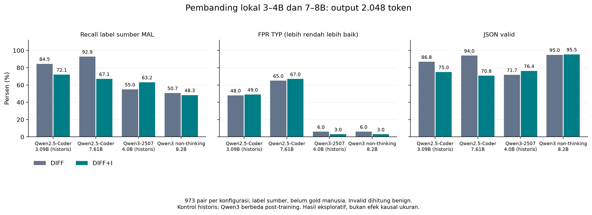

# Pembanding model lokal 3–4B dan 7–8B — D83

**Selesai pada 1 Oktober 2026, 00:04 WIB: 3.892 inferensi baru terverifikasi,
tanpa error transport atau pengulangan request.** Model lebih besar tidak
memberi peningkatan merata: Qwen2.5-7B DIFF menaikkan recall sumber sekaligus
FPR; Qwen2.5-7B DIFF+I dan kedua konfigurasi Qwen3-8B menurunkan recall
dibanding kontrol masing-masing.

Bobot kedua model, 22 checksum snapshot, 13 checksum kontrol, token seluruh
prompt, dan jumlah request dalam log server telah diperiksa.
[Bukti audit](../data/evaluation/model-scale-20260930/verification.json),
[protokol beku](../data/evaluation/model-scale-20260930/protocol.json), dan
[status akhir](../data/evaluation/model-scale-20260930/status.json) tersedia.

Pengguna menyetujui tahap pertama dari [usulan model](model-scale-proposal-20260930.md).
Qwen2.5-Coder-7B-Instruct dan Qwen3-8B non-thinking dievaluasi pada seluruh
973 pair yang sama dengan D82: 873 MAL berlabel sumber dan 100 TYP yang
diasumsikan benign. Masing-masing memakai DIFF dan DIFF+I, sehingga ada
3.892 inferensi baru. Kontrol historis adalah 3.892 hasil D82 pada batas
keluaran yang sama, 2.048 token. Total perbandingan: 7.784 respons.

| Kelompok operasional | Checkpoint | Parameter total | Peran |
|---|---|---:|---|
| A: 1 ≤ P < 5B | Qwen2.5-Coder-3B-Instruct | 3,09B | Kontrol historis D82 |
| A: 1 ≤ P < 5B | Qwen3-4B-Instruct-2507 | 4,0B | Kontrol historis D82 |
| B: 5 ≤ P < 10B | Qwen2.5-Coder-7B-Instruct | 7,61B | Inferensi baru |
| B: 5 ≤ P < 10B | Qwen3-8B, non-thinking | 8,2B | Inferensi baru |

Batas kelompok ini dipakai untuk penyajian, bukan kategori baku atau
dasar untuk menggeneralisasi rata-rata kelompok ke semua model.

## Hasil seluruh konfigurasi

| Model | Konfigurasi | Recall MAL sumber | FPR TYP | JSON valid | Macro recall kampanye |
|---|---|---:|---:|---:|---:|
| Qwen2.5-Coder-3B, historis | DIFF | 84,54% | 48% | 86,84% | 78,69% |
| Qwen2.5-Coder-3B, historis | DIFF+I | 72,05% | 49% | 75,03% | 56,48% |
| Qwen2.5-Coder-7B | DIFF | 92,90% | 65% | 94,04% | 93,05% |
| Qwen2.5-Coder-7B | DIFF+I | 67,12% | 67% | 70,81% | 71,47% |
| Qwen3-4B-Instruct-2507, historis | DIFF | 54,98% | 6% | 71,74% | 42,38% |
| Qwen3-4B-Instruct-2507, historis | DIFF+I | 63,23% | 3% | 76,36% | 54,05% |
| Qwen3-8B non-thinking | DIFF | 50,74% | 6% | 94,96% | 37,87% |
| Qwen3-8B non-thinking | DIFF+I | 48,34% | 3% | 95,48% | 33,27% |

Setiap baris memakai 873 MAL, 100 TYP, dan 973 respons. Invalid dihitung
benign. FPR lebih rendah lebih baik. Ini metrik label sumber, bukan akurasi
gold atau estimasi performa pada populasi npm. Angka kontrol berasal dari
D82 pada 2.048 token, bukan baseline D81 pada 512 token.

[CSV lengkap](../data/evaluation/model-scale-20260930/comparison.csv),
[JSON beserta sensitivitas dan biaya](../data/evaluation/model-scale-20260930/comparison.json),
[grafik PDF](../data/evaluation/model-scale-20260930/comparison.pdf), dan
[respons mentah baru](../data/evaluation/model-scale-20260930/results.jsonl).

## Apa yang berubah dan mengapa perlu hati-hati

| Perbandingan ukuran, konfigurasi sama | Δ recall (poin persentase) | Δ FPR (poin persentase) | Δ deteksi MAL: kedua respons valid | Δ deteksi MAL: melibatkan invalid |
|---|---:|---:|---:|---:|
| Qwen2.5 3B → 7B, DIFF | +8,36 | +17 | +27 | +46 |
| Qwen2.5 3B → 7B, DIFF+I | −4,93 | +18 | +13 | −56 |
| Qwen3 4B → 8B, DIFF | −4,24 | 0 | −178 | +141 |
| Qwen3 4B → 8B, DIFF+I | −14,89 | 0 | −226 | +96 |

Kolom terakhir adalah hitungan deteksi bersih pada 873 MAL, bukan persen;
dua kolom itu menjumlah menjadi perubahan deteksi total. Ini dekomposisi
deskriptif berpasangan, bukan estimasi kausal perubahan penalaran.

**Qwen2.5-7B DIFF** mencapai recall tertinggi, tetapi salah menandai 65 dari
100 TYP. Kenaikan 73 deteksi MAL terdiri dari +27 pada pasangan dengan
kedua respons valid dan +46 melalui perubahan validitas. Seluruh tambahan
17 false positive terjadi melalui transisi yang melibatkan invalid;
aturan invalid-as-benign memengaruhi kedua metrik tersebut.

**DIFF+I pada Qwen2.5-7B masih bermasalah secara format.** Ada 284 respons
invalid: 263 kesalahan sintaks JSON dan 21 terpotong. DIFF hanya memiliki
58 invalid. Penurunan DIFF → DIFF+I sebesar 225 deteksi MAL terdiri dari
−220 melalui transisi valid/invalid dan −5 pada pasangan yang sama-sama
valid. Karena itu, penurunan tersebut tidak boleh disebut bukti bahwa
intent menurunkan kemampuan penalaran sebesar 25,77 poin.

**Qwen3-8B lebih konsisten mengeluarkan JSON, tetapi recall lebih rendah.**
Penurunan tetap terlihat pada pasangan yang kedua responsnya valid dan
pada macro recall kampanye. Ini bukan hanya masalah parser. Checkpoint
4B-Instruct-2507 dan 8B berbeda post-training; hasil tidak membuktikan
bahwa menambah parameter menyebabkan penurunan. Request non-thinking
dan template server telah diverifikasi, dan tidak ada respons baru yang
memuat tag pembuka `<think>`.

**Distribusi kampanye juga berpengaruh.** Ada 224 kampanye MAL; kampanye
terbesar mencakup 607 dari 873 pair. Qwen2.5-7B DIFF+I memiliki recall
per-pair lebih rendah daripada 3B, tetapi macro recall kampanye lebih
tinggi (71,47% versus 56,48%). Kedua metrik harus dilaporkan agar hasil
tidak hanya mencerminkan kampanye terbesar.

Jumlah invalid turun dari 876 pada empat kelompok kontrol menjadi 435
pada empat kelompok baru; respons terpotong 202 → 45. Peningkatan format
agregat ini tidak setara dengan peningkatan kualitas deteksi.
[Dekomposisi yang dapat direproduksi](../data/evaluation/model-scale-20260930/diagnostics.json)
mencakup perubahan ukuran dan DIFF → DIFF+I pada setiap model baru.

## Kontrol eksperimen

Input, prompt, parser, invalid-as-benign, BF16, seed 0, temperature 0,
top_p 1, konteks 32.768, dan output maksimum 2.048 dipertahankan dari D82.
Qwen3-8B menerima `chat_template_kwargs={"enable_thinking": false}`.
Tidak ada pemotongan input tambahan, pemanasan LLM sintetis, kuantisasi,
fine-tuning, atau pemilihan pair berdasarkan keluaran.

Model berjalan bergantian pada RTX 5090, `max_num_seqs=1` dan prefix
caching aktif. Alokasi GPU berubah dari 0,65 pada kontrol historis menjadi
0,80 untuk kedua model baru agar bobot/cache lebih besar muat. Latency
bersifat observasional antar-sesi. Perbandingan Qwen3 juga mencakup
perbedaan checkpoint/post-training; ukuran bukan satu-satunya faktor.

## Verifikasi dan keluaran

Snapshot berada di [direktori eksperimen](../data/evaluation/model-scale-20260930/).
Sebelum inferensi: pin revisi dan checksum bobot, audit tokenisasi 3.892
prompt, pembekuan protokol, pemeriksaan payload tanpa jaringan, dan dua
request `/tokenize` per model tanpa generasi.

Sesudah inferensi: pemeriksaan respons mentah dan parser, kelengkapan
973 pair pada setiap konfigurasi, token aktual versus audit, checksum
snapshot, serta jumlah request HTTP dalam log server. Laporan menyajikan
recall MAL sumber, FPR TYP, JSON valid, jenis invalid, sensitivitas
invalid-as-malicious, macro recall kampanye, transisi prediksi berpasangan,
token, dan latency. Seluruh kombinasi dilaporkan termasuk yang memburuk.

Seluruh pemeriksaan akhir lulus. Setiap model mencatat 1.946 request
generasi HTTP 200 dan dua request tokenisasi HTTP 200. Tidak ada retry,
error transport, pemotongan input tambahan, atau perubahan protokol di
tengah batch. Ruang konteks minimum setelah cadangan output adalah 1.387
token. Kedua server berhenti normal. Total token baru: 17.059.582 prompt
dan 865.508 completion. Eksekusi berlangsung 30 September 20:44 sampai
1 Oktober 00:04 WIB.

Median/p95 latency baru, dalam ms: Qwen2.5 DIFF 1.440,5/4.284,0;
DIFF+I 1.472,6/4.872,5; Qwen3 DIFF 1.189,2/24.288,2;
DIFF+I 1.520,1/24.084,5. Ini biaya sesi aktual, bukan benchmark kausal.

## Langkah penelitian berikutnya

Hasil ini sudah dapat ditulis sebagai **hasil eksploratif pembanding ukuran**,
termasuk hasil negatifnya. Klaim kenaikan umum akibat ukuran tidak didukung
oleh pola empat perbandingan ini. Pada tahap berikutnya, prioritaskan
diagnosis/perbaikan format di dev set terpisah dan penyelesaian anotasi
gold/HN serta card KB. Jangan menyetel prompt pada 973 pair ini lalu
menyebut evaluasi ulangnya sebagai test konfirmatori independen.

Perubahan format perlu dibekukan sebagai eksperimen baru dan diterapkan
konsisten pada semua model/config pembanding; snapshot D83 tetap utuh.
Kegagalan format Qwen2.5 DIFF+I dan perubahan verdict valid Qwen3 adalah
dua masalah berbeda yang perlu dianalisis terpisah. Menambah model lebih
besar lagi belum menjadi solusi yang dibuktikan oleh hasil ini.

Ini evaluasi eksploratif setelah hasil awal diketahui. Belum ada gold
manusia, HN, evaluasi retrieval, atau uji hipotesis konfirmatori. G1/G2
belum selesai. Pemeriksaan cutoff rilis untuk analisis temporal formal
belum dilakukan terhadap model baru. RQ inti 3–4B dan enam konfigurasi
retrieval tidak otomatis diperluas oleh pembanding tambahan ini.

Rujukan model dan penelitian terkait: [usulan beserta sumber primer](model-scale-proposal-20260930.md).
Keputusan sebelum inferensi: [D83](decisions.md).
Inventaris checksum hasil dan dokumen: [manifest artefak](../data/evaluation/model-scale-20260930/artifact-manifest.json).
