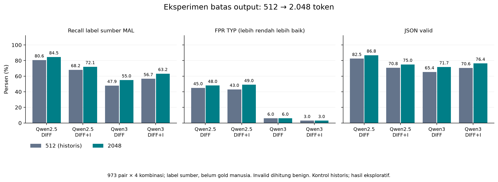

# Hasil eksperimen batas keluaran 512 → 2.048 token

Selesai 30 September 2026, mengikuti D82 yang dibekukan 29 September.
Sebanyak **3.892 inferensi baru** selesai pada 973 pair asli × dua konfigurasi
× dua model. Semua respons HTTP 200, tanpa retry atau error transport.
Baseline adalah 3.892 respons historis D81. Prompt, parser, masukan, seed,
sampling, dan konfigurasi server yang tercatat sama; faktor request yang
diubah hanya `max_tokens`. GPU telah dilepas oleh kedua server setelah selesai.

**Recall label sumber naik pada seluruh kombinasi, tetapi perbaikan tidak
merata: FPR Qwen2.5 memburuk, sedangkan FPR Qwen3 tetap.** Ini hasil eksploratif,
bukan bukti superioritas terhadap paper utama atau hasil konfirmatori.

| Model | Konfigurasi | Recall MAL 512 → 2048 | Δ recall (poin persentase) | FPR TYP 512 → 2048 | JSON valid 512 → 2048 |
|---|---|---:|---:|---:|---:|
| Qwen2.5-Coder-3B | DIFF | 80,64% → 84,54% | +3,89 | 45% → 48% | 82,53% → 86,84% |
| Qwen2.5-Coder-3B | DIFF+I | 68,16% → 72,05% | +3,89 | 43% → 49% | 70,81% → 75,03% |
| Qwen3-4B | DIFF | 47,88% → 54,98% | +7,10 | 6% → 6% | 65,36% → 71,74% |
| Qwen3-4B | DIFF+I | 56,70% → 63,23% | +6,53 | 3% → 3% | 70,61% → 76,36% |

Denominator per baris: 873 MAL berlabel sumber, 100 TYP diasumsikan benign,
973 respons untuk validitas JSON. Output invalid tetap dihitung benign.
Selisih dihitung dari hitungan asli sebelum pembulatan persentase.



## Mengapa metrik berubah

Pada Qwen2.5, masing-masing konfigurasi memperoleh **34 deteksi MAL tambahan**.
Seluruh tambahan berasal dari respons invalid yang menjadi valid-malicious;
tidak ada perubahan verdict MAL di antara respons yang sama-sama valid.
Tambahan false positive TYP juga berasal dari pemulihan invalid menjadi
valid-malicious: tiga untuk DIFF dan enam untuk DIFF+I. Jadi kenaikan recall
bukan bukti bahwa penalaran klasifikasi pada respons valid menjadi lebih baik.

Selisih Qwen2.5 DIFF+I versus DIFF tetap **−109 deteksi MAL atau −12,49 poin**.
Pada 2.048 token, dekomposisinya −105 melalui transisi yang melibatkan invalid
dan −4 melalui perubahan verdict yang sama-sama valid. Ini memperkuat bahwa
selisih agregat masih sangat dipengaruhi kegagalan keluaran. Subset yang
sama-sama valid bersifat terseleksi dan tidak boleh menggantikan metrik utama
atau dianggap estimasi kausal efek intent.

Pada Qwen3, DIFF memperoleh tambahan bersih 62 deteksi MAL, seluruhnya melalui
transisi valid/invalid. DIFF+I memperoleh tambahan 57: 56 melalui transisi
valid/invalid dan satu dari benign menjadi malicious pada respons sama-sama
valid. FPR tetap 6/100 dan 3/100. Pada batas baru, DIFF+I dibanding DIFF memberi
recall +8,25 poin dan FPR −3 poin; ini tetap perbandingan deskriptif.

| Model/config | Terpotong 512 → 2048 | Invalid sintaks JSON 512 → 2048 | Invalid schema 512 → 2048 |
|---|---:|---:|---:|
| Qwen2.5 DIFF | 143 → 75 | 27 → 53 | 0 → 0 |
| Qwen2.5 DIFF+I | 234 → 118 | 50 → 125 | 0 → 0 |
| Qwen3 DIFF | 76 → 7 | 249 → 255 | 12 → 13 |
| Qwen3 DIFF+I | 67 → 2 | 199 → 208 | 20 → 20 |

Total invalid turun dari **1.077 menjadi 876**, dan terpotong dari 520 menjadi
202. Dari 520 respons baseline yang terpotong, 203 kini valid, 202 tetap
terpotong, 114 selesai dengan sintaks JSON salah, dan satu gagal schema.
Anggaran lebih besar mengungkap kegagalan sintaks yang sebelumnya tertutup
oleh batas token. Validitas JSON seluruh konfigurasi masih di bawah 90% pada
korpus ini; korpus ini bukan dev set §3.5.

## Batas interpretasi dan biaya

Kontrol 512 token berasal dari sesi sebelumnya. Kesamaan respons yang dulu
berhenti normal adalah 827/830 dan 734/739 untuk Qwen2.5; 864/897 dan 865/906
untuk Qwen3, masing-masing DIFF dan DIFF+I. Awalan respons yang dulu terpotong
cocok pada 143/143, 234/234, 75/76, dan 67/67 kasus. Semua konfigurasi server
yang tercatat cocok, tetapi penyebab perbedaan respons antar-sesi belum
dipastikan. Tidak semua perubahan individual dapat diatribusikan murni
kepada batas token; tidak ada rerun kontrol 512 yang kontemporer.

Macro recall yang memberi bobot sama kepada tiap klaster MAL juga naik:
Qwen2.5 DIFF 76,66% → 78,69%; DIFF+I 50,29% → 56,48%; Qwen3 DIFF
37,22% → 42,38%; DIFF+I 49,82% → 54,05%. Tetap ada ketimpangan besar:
klaster terbesar memuat 607 dari 873 pair MAL, dengan total 224 klaster.

Total token baru 18.392.679 versus 17.755.330 pada baseline. p95 latency sesi
meningkat dari sekitar 3,6–4,1 detik menjadi 14,1–15,3 detik. Median relatif
dekat: 1.088,2/1.414,1 ms untuk Qwen2.5 dan 828,6/892,6 ms untuk Qwen3.
Angka antar-sesi ini deskriptif, bukan benchmark kausal RQ4; request awal dan
prefix caching tetap tercakup. Analisis sensitivitas invalid-as-malicious
tersedia dalam `summary.json` dan tidak menggantikan angka primer di atas.

Masih belum ada gold manusia, HN, retrieval, atau verifikasi evidence gold.
G1/G2 belum selesai. Hasil ini dapat ditulis sebagai eksperimen eksploratif
dan diagnosis kegagalan format, bukan hasil utama yang membuktikan hipotesis
atau klaim mengungguli paper lintas dataset.

## Langkah berikutnya

1. Bentuk dev set terpisah sesuai §3.5 dan periksa validitas JSON di sana.
   Jika salah satu model di bawah 90%, §6.4 mengizinkan **satu revisi instruksi
   format di akhir pesan user sebelum G2**, berlaku untuk kedua model dan
   seluruh konfigurasi; system prompt dan aturan keputusan tetap. Catat
   revisinya sebelum inferensi. Jangan menyetel prompt untuk mengejar recall
   pada 973 pair yang sudah berulang kali dilihat ini.
2. Lengkapi dua anotator, konsensus, HN, evidence gold, dan card KB terverifikasi
   agar studi utama bisa dijalankan. Batas 2.048 token belum otomatis menjadi
   default studi utama; pemilihannya harus dibekukan bersama desain sebelum G2.
3. Setelah pembekuan, jalankan seluruh konfigurasi pada test final yang
   ditetapkan protokol dan laporkan juga hasil negatif serta sensitivitas.

## Artefak dan reproduksi

- [Tabel lengkap](../data/evaluation/output-budget-20260929/comparison.md),
  [CSV](../data/evaluation/output-budget-20260929/comparison.csv),
  [grafik PDF](../data/evaluation/output-budget-20260929/comparison.pdf).
- [Ringkasan dan sensitivitas](../data/evaluation/output-budget-20260929/summary.json),
  [dekomposisi transisi](../data/evaluation/output-budget-20260929/diagnostics.json),
  [verifikasi akhir](../data/evaluation/output-budget-20260929/verification.json),
  [protokol beku](../data/evaluation/output-budget-20260929/protocol.json).
- Respons mentah, log, dan checksum berada di direktori eksperimen. Identitas
  folder/tanggal judul laporan otomatis mengikuti pembekuan 29 September;
  timestamp hasil mencatat pelaksanaan dan penyelesaian 30 September.
- Percobaan awal 29 September gagal pada `cuInit` sebelum prediksi apa pun.
  Pada 30 September inisialisasi CUDA berhasil dan controller yang sama
  dilanjutkan tanpa perubahan lingkungan atau protokol. Log kegagalan tetap
  disimpan; penyebab awal belum dikonfirmasi.

```bash
.venv/bin/python data/evaluation/output-budget-20260929/summarize.py
.venv/bin/python data/evaluation/output-budget-20260929/compare.py
.venv/bin/python scratchpad/output-budget-20260929/diagnose.py
.venv/bin/python scratchpad/output-budget-20260929/verify_final.py
.venv/bin/python scratchpad/output-budget-20260929/plot_comparison.py
```

Perintah di atas hanya menganalisis respons yang sudah tersimpan, tanpa
inferensi baru. Pengulangan laporan dapat mengubah timestamp keluaran;
manifest mengabadikan checksum artefak saat penutupan eksperimen ini.
